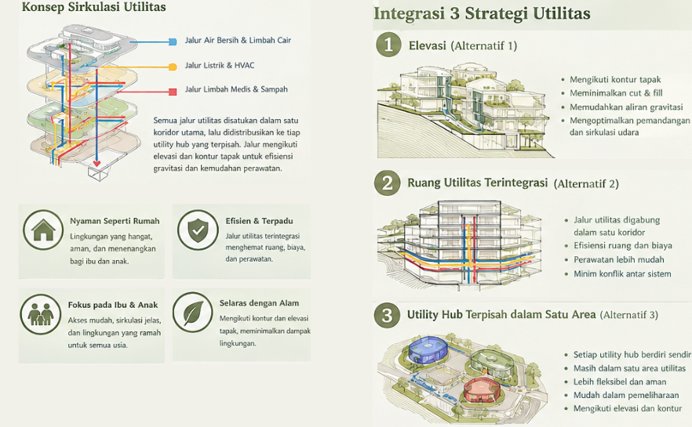

  <!-- Header Banner Arsitektur Minimalis & Modern -->
  

  <!-- Typing SVG Animation -->
  

    

  <!-- Badge Link Sosial & Portofolio -->
  
  
  
  

---

### 🏛️ Tentang Saya (About Me)

Halo! Saya adalah pegiat **Arsitektur dan Desain Grafis** yang berfokus pada perancangan ruang kontekstual, pemodelan berbasis **BIM (Building Information Modeling)**, serta komunikasi visual arsitektur yang estetik dan komunikatif.

- 📐 **Fokus Utama:** Perancangan Arsitektur, Pemodelan 3D, Penyusunan Dokumen DED (Detail Engineering Design), dan *Visual Storytelling*.
- 📍 **Kekuatan Khusus:** **Analisis Site Komprehensif** (orientasi tapak, iklim mikro, sirkulasi urban, serta integrasi topografi dengan massa bangunan).
- 🎨 **Pendekatan Visual:** Menggabungkan ketepatan teknis arsitektur dengan estetika desain grafis (*post-digital collage*, diagram konsep, dan presentasi sayembara/klien).
- 💼 **Portofolio Online:** [Lihat Portofolio Lengkap Saya di Sini](https://behance.net/USERNAME_ANDA)

---

### 🛠️ Keahlian & Perangkat Lunak (Tools & Stack)

  <h4>📐 Architecture, BIM & 3D CAD</h4>
  
  
  

    

  <h4>🎨 Desain Grafis, Layout & Post-Production</h4>
  
  
  

---

### 📍 Fokus Spesialisasi: Analisis Site & Perancangan

Dalam setiap proses perancangan, pendekatan diawali dengan analisis tapak (*Site Analysis*) mendalam untuk memastikan bangunan responsif terhadap lingkungan:

   
  
  
<i>📐 Diagram Analisis Site, Orientasi Massa & Respon Lingkungan</i>

   

| Aspek Analisis | Deskripsi & Pendekatan | Output Visual |
| :--- | :--- | :--- |
| ☀️ **Klimatologi & Orientasi** | Analisis lintasan matahari (*Sun Path*), arah angin dominan, dan bayangan musiman. | Diagram Isometrik Matahari & Angin |
| 🚗 **Aksesibilitas & Sirkulasi** | Studi pola pergerakan pejalan kaki, kendaraan pribadi, servis, dan transportasi publik. | Peta Zonasi & Flow Diagram |
| ⛰️ **Topografi & Kontur** | Pengolahan kontur tanah, *cut and fill*, drainase alami tapak, dan vegetasi eksisting. | Potongan Tapak & Model 3D Terrain |
| 🏙️ **Konteks Urban & Regulasi** | Analisis KDB, KLB, GSB, tata guna lahan sekitar, serta respon terhadap fasad kawasan. | Diagram Matriks Zonasi & Analisis Konteks |

---

### 📂 Portofolio Pilihan (Featured Projects)

<!-- Anda bisa menyematkan gambar thumbnail atau link ke file proyek Anda -->

| Proyek | Kategori | Software yang Digunakan | Tautan Proyek |
| :--- | :--- | :--- | :--- |
| **01. Residential Eco-Living House** | Desain Hunian Tropis | AutoCAD, SketchUp, Photoshop | [Lihat Proyek ↗](https://github.com/GITHUB_USERNAME) |
| **02. Urban Public Library & Community Center** | Bangunan Publik / BIM | Revit, AutoCAD, CorelDRAW | [Lihat Proyek ↗](https://github.com/GITHUB_USERNAME) |
| **03. Comprehensive Site Analysis & Masterplan** | Studi Kawasan & Tapak | AutoCAD, Photoshop, Canva | [Lihat Proyek ↗](https://github.com/GITHUB_USERNAME) |
| **04. Architectural Presentation Boards** | Desain Grafis & Sayembara | CorelDRAW, Photoshop, Canva | [Lihat Proyek ↗](https://github.com/GITHUB_USERNAME) |

---

### 📊 Aktivitas & Statistik GitHub

  <!-- Ganti GITHUB_USERNAME dengan username akun GitHub Anda -->
  
  

    

  

---

  <!-- Footer Banner Gelombang Tema Arsitektur -->
  

  
<i>"Architecture is really about well-being. I think that people want to feel good in a space." — Zaha Hadid</i>

  
Terbuka untuk kolaborasi proyek arsitektur, freelance grafis, atau magang!

